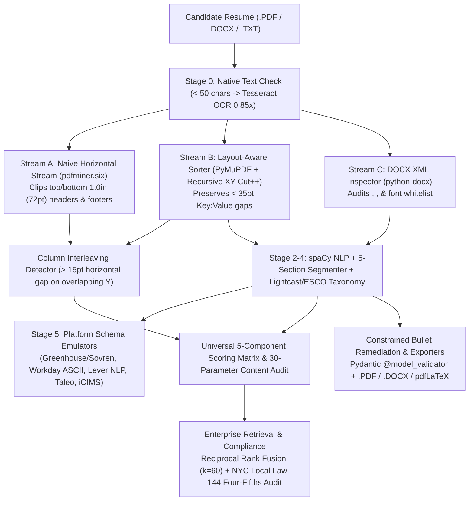

# Glass-Box ATS Simulator & Optimization Studio

> **100% Deterministic Clean-Room Applicant Tracking System (ATS) Parser, Multi-Platform Schema Emulator, 5-Component Scoring Matrix, Hybrid RRF Search Engine, and Zero-Hallucination Remediation Studio.**

Unlike black-box resume scanners that output arbitrary single-number scores, **Glass-Box ATS Simulator** exposes the exact spatial geometry, byte streams, platform-specific JSON schemas, mathematical weight vectors, and regulatory bias telemetry used across enterprise recruiting pipelines (**Workday**, **Greenhouse / Sovren**, **Lever**, **iCIMS**, and **Taleo**).

---

## System Architecture



---

## Core Engineering Highlights

### 1. Dual-Stream Spatial Ingestion (`backend/services/extractor.py`)
- **Stream A (Naive Horizontal Stream):** Uses `pdfminer.six` to read glyphs strictly left-to-right across the full page width, clipping text inside the top 1.0 inch (`y0 < 72pt`) and bottom 1.0 inch (`y1 > page_height - 72pt`) to expose header/footer contact loss.
- **Stream B (Layout-Aware Block Sorter):** Uses `PyMuPDF` (`fitz`) and recursive **XY-Cut++** bounding-box projection to segment multi-column layouts into human reading order while preserving horizontal gaps `< 35pt` for `Key : Value` pairs.
- **Column Interleaving Detector:** Compares line sequences between Stream A and Stream B; any horizontal gap `> 15pt` on overlapping baselines that concatenates across Stream A triggers a graduated Parse Success deduction (`-33` to `-46` points).
- **Stage 0 OCR Fallback:** Triggers `pytesseract` when native characters `< 50`, applying an automatic `0.85` confidence multiplier.

### 2. Platform-Specific JSON Schema Emulators (`backend/services/schema_emulators.py`)
- **Greenhouse (Sovren Profile):** Splits `first_name`/`last_name`, formats integer `start_month`/`start_year`, preserves structured `description_bullets` arrays, separates `degree` and `major`, and retains multi-word analytical skills (`"A/B testing"`).
- **Workday (Enterprise ASCII Profile):** Merges `name`, enforces `YYYY-MM-DD` date strings, concatenates bullets into a single paragraph, collapses degrees into generic tiers, and drops multi-word soft skills.
- **Lever (NLP Pattern Profile):** Extracts top-level `headline`, formats dates as `YYYY-MM` with literal `"Present"`, joins bullets with `\n`, and truncates skills to the first 4 extracted tags (`tags[:4]`).

### 3. Universal 5-Component ATS Scoring Matrix (`backend/services/ats_score.py`)
$$\text{Score} = (\text{Keyword Match} \times W_1) + (\text{Placement} \times W_2) + (\text{Sections} \times W_3) + (\text{Parse Success} \times W_4) + (\text{Relevance} \times W_5)$$

| Platform | $W_1$ (Keyword) | $W_2$ (Placement) | $W_3$ (Sections) | $W_4$ (Parse) | $W_5$ (Relevance) | Matching Logic |
| :--- | :---: | :---: | :---: | :---: | :---: | :--- |
| **WORKDAY** | `0.50` | `0.10` | `0.20` | `0.15` | `0.05` | Exact match + stemming |
| **TALEO** | `0.55` | `0.08` | `0.17` | `0.15` | `0.05` | Strict verbatim match |
| **ICIMS** | `0.45` | `0.12` | `0.18` | `0.15` | `0.10` | Boolean-weighted hybrid |
| **LEVER** | `0.40` | `0.15` | `0.15` | `0.15` | `0.15` | Dense vector semantic (`+0.5` neighbor credit) |
| **GREENHOUSE** | `N/A` | `N/A` | `N/A` | `N/A` | `N/A` | Human scorecard mode (no auto-score) |

### 4. Hybrid Search (RRF $k=60$) & NYC Local Law 144 Bias Auditing (`backend/services/hybrid_search.py`)
- **Reciprocal Rank Fusion:** Combines sparse lexical BM25 rankings with dense semantic ANN rankings:
  $$\text{RRF\_Score}(d) = \sum_{r \in \{\text{BM25}, \text{ANN}\}} \frac{1}{60 + \text{rank}_r(d)}$$
- **NYC Local Law 144 Disparate Impact Telemetry:** Computes selection/scoring rates per demographic group and flags adverse impact whenever $\text{Impact Ratio}_g < 0.80$ (EEOC Four-Fifths Rule).

### 5. Interactive 4-Tab Next.js Studio (`frontend/`)
1. **Tab 1 — Parser X-Ray (`ParserXRay.tsx`):** Drag-and-drop PDF/DOCX/TXT ingestion, Stream A vs. Stream B inspection, spatial bounding-box coordinates, and 5-platform emulator switcher.
2. **Tab 2 — Diagnostic & 30-Point Audit (`DiagnosticDashboard.tsx`):** Circular gauges for JD Keyword Match Rate (`75%–85%` optimal band), Parse Success, and 30-Parameter Audit Score, plus Knockout Gate simulation, RRF Tournament, and NYC LL144 Audit.
3. **Tab 3 — Diff Editor & Safe Exporter (`TailoringStudio.tsx`):** Before-and-after bullet diffs validated by Pydantic `@model_validator(mode="after")` with 1-click export to single-column `.PDF`, `.DOCX`, and Overleaf `pdfLaTeX` (`.tex`).
4. **Tab 4 — Application Kanban (`KanbanBoard.tsx`):** Track applications across **Applied**, **Screening**, **Interview**, and **Offer** with persistent storage.

---

## Quickstart

### Option A: Docker Compose (PostgreSQL 16 + `pgvector` + Backend + Frontend)
```bash
docker compose up --build
```
- **Frontend Studio:** `http://localhost:3000`
- **FastAPI Backend & OpenAPI Docs:** `http://localhost:8000/docs`
- **PostgreSQL 16 + `pgvector`:** `localhost:5432` (auto-initialized with `backend/db/schema.sql`)

### Option B: Local Development
```bash
# 1. Run the 24-test backend verification suite
make test

# 2. Start the FastAPI backend on port 8000
make dev-backend

# 3. Start the Next.js frontend studio on port 3000
make dev-frontend
```

---

## Verification & Test Suite
Run the complete unit, ground-truth benchmark, and API endpoint integration test suite:
```bash
.venv/bin/pytest backend/tests/ -v
```
- `backend/tests/test_extractor.py`: OCR fallback (`0.85x`), Stream A 1.0-inch clipping, Stream B `XY-Cut++` column sorting, `<35pt` key-value preservation, and DOCX XML auditing.
- `backend/tests/test_nlp_pipeline.py`: Unicode bullet hazard sanitization, 5-section segmentation, non-standard header failure detection, and Lightcast/ESCO taxonomy normalization.
- `backend/tests/test_schema_emulators.py`: Sarah Chen ground-truth benchmarks for Greenhouse, Workday, and Lever (`tags[:4]` truncation).
- `backend/tests/test_ats_score.py`: Senior Python Developer ground-truth benchmarks (`82.0` Workday, `85.75` Lever), Greenhouse manual scorecard mode, and 30-parameter audit checklist.
- `backend/tests/test_hybrid_search.py`: 3-candidate RRF ($k=60$) tournament, NYC Local Law 144 Four-Fifths Rule bias audit, and zero-hallucination Pydantic `@model_validator` enforcement.
- `backend/tests/test_api_endpoints.py`: Full HTTP integration tests for all `/api/v1/*` routes, security headers, upload guardrails, and PDF/DOCX export re-ingestion.
